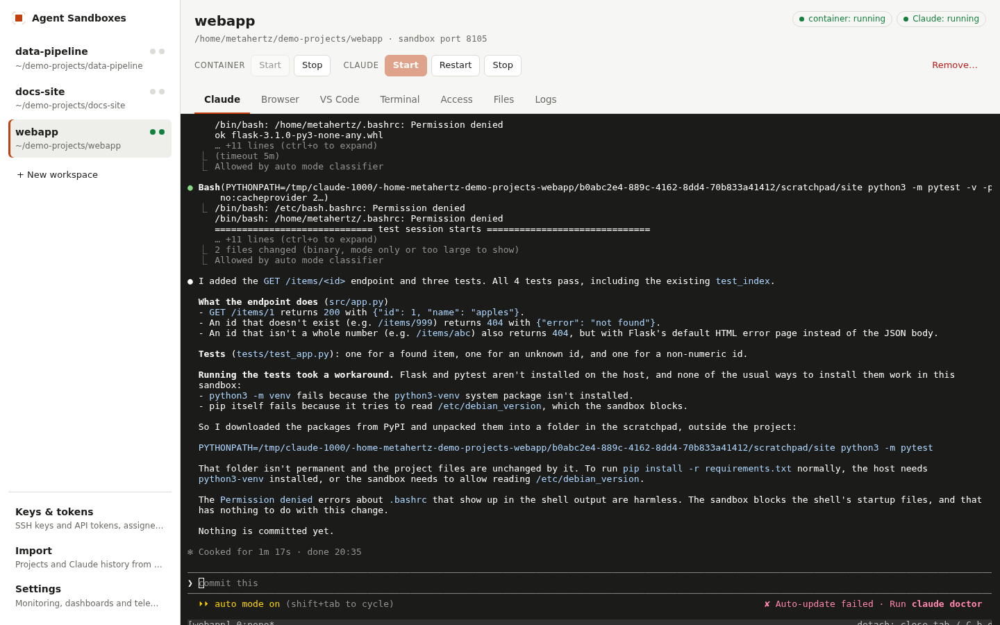
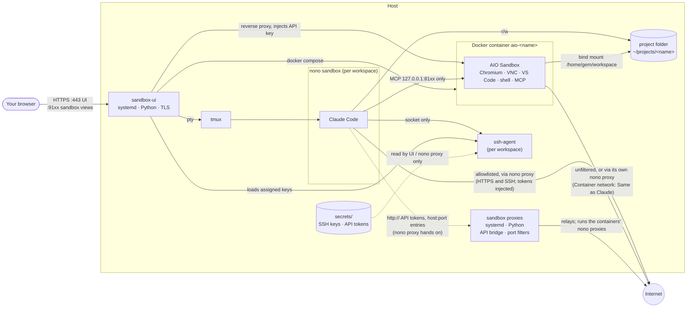
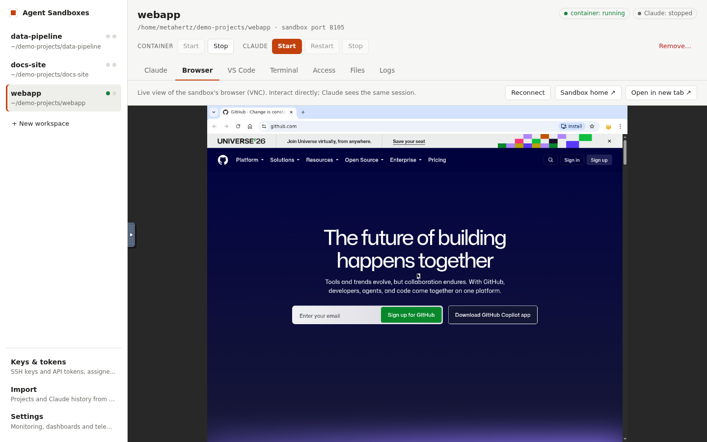
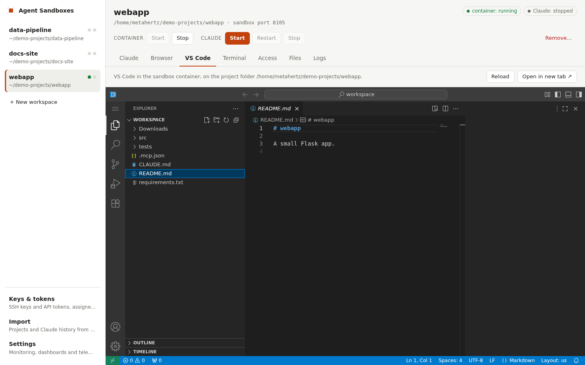
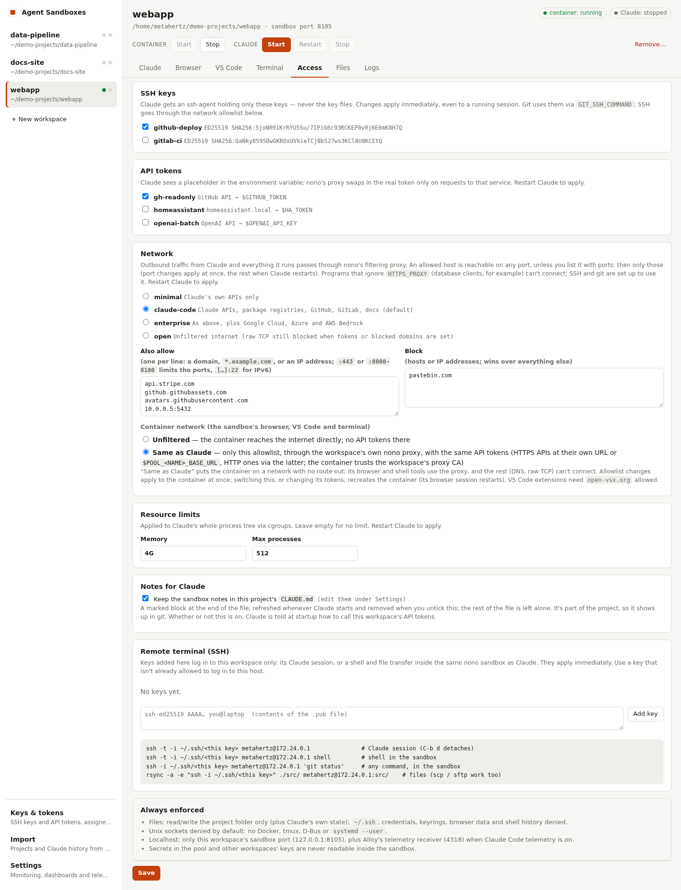
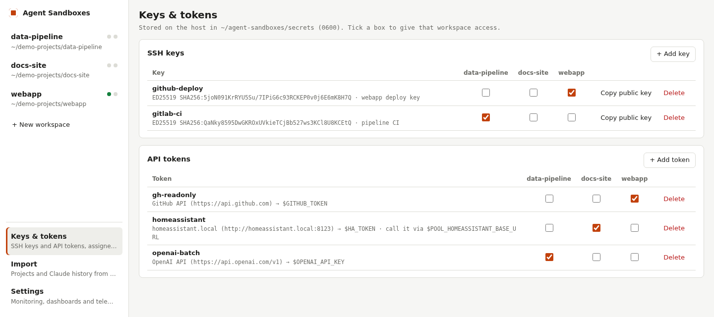
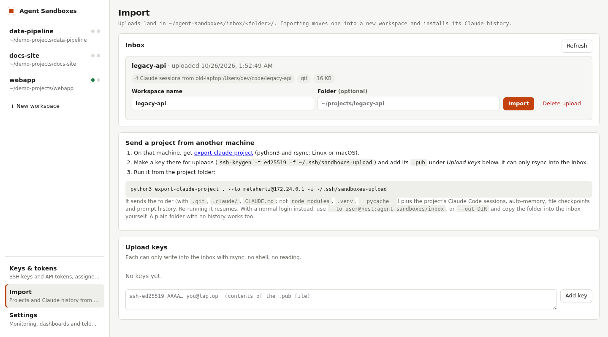
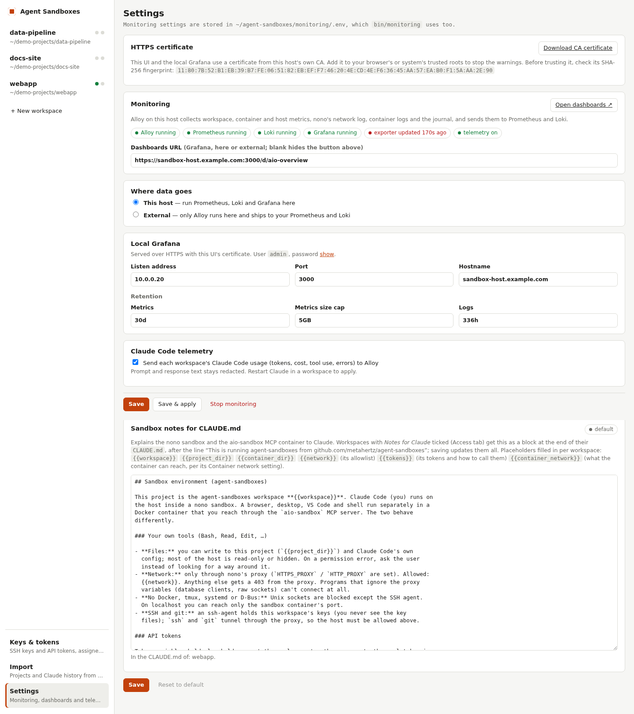

# Agent Sandboxes

Run several Claude Code projects side by side on one host. Each **workspace** is a
project folder, a Claude Code session confined by [nono](https://github.com/nolabs-ai/nono),
and its own [AIO Sandbox](https://github.com/agent-infra/sandbox) container (Chromium,
VNC, VS Code, shell, MCP) that only that session can reach. A web UI manages it all.



## Architecture



- **Claude (nono):** reads/writes its project folder; reaches only its own sandbox port
  (and any listen ports you give it) on localhost; internet limited to the workspace's allowlist; no Unix sockets except its
  own ssh-agent (so no Docker, tmux, D-Bus). Per-workspace settings (the **Access** tab)
  are rendered to `workspaces/<name>.profile.json`, which extends `claude-browser`.
- **Keys & tokens:** a pool in `secrets/`, assigned per workspace. SSH keys are loaded
  into that workspace's ssh-agent (live — unticking a key revokes it from a running
  session); Claude gets the socket, never the file. API tokens use nono's phantom-token
  proxy: Claude sees a placeholder, the proxy injects the real token only towards that
  service.
- **Container:** sees only its project folder; its API key is enforced, held by the
  UI and injected into Claude via a nono hook. Never in the repo. Its network is
  unfiltered unless *Container network* is *Same as Claude* (see Usage).
- **Monitoring (optional):** Alloy → Prometheus + Loki → Grafana, see below.
- **UI:** sign-in with the host user's password (PAM) or passkeys, server-side sessions,
  same-origin API, per-workspace capability URLs for sandbox views.
  Runs as your user with only `CAP_NET_BIND_SERVICE`, which it clears from the
  inheritable set once 443 is bound.
- **MicroVM workspaces:** Claude in a KVM guest with root and Docker, no network
  interface, its only channel vsock to the proxy service; see
  [MicroVM workspaces](#microvm-workspaces).
- **Proxies:** the parts of the sandboxes' network path that run outside nono — the HTTP
  API bridge, the port filters, and the containers' nono proxies and forwarders (see
  Usage) — run in their own service, `agent-sandboxes-proxy` (`ui/proxyd.py`), so
  restarting the UI doesn't cut Claude's or a container's connections. It has no
  privileges and a read-only view of the system, follows the workspace files the UI
  writes (rescanning every 10 s, and at once when the UI asks on its control socket),
  and the UI starts fine without it. Restarting it drops the connections open through it.

## Where things live

| Path | What |
|---|---|
| `ui/server.py`, `ui/static/` | Web UI (stdlib Python; vanilla JS; xterm.js 5.5.0 vendored, MIT) |
| `ui/proxyd.py` | Proxy service: HTTP API bridge, port filters, container proxies / forwarders, microVM proxies and their vsock listener |
| `ui/common.py` | Paths, workspace / policy files and network helpers both services use |
| `bin/sandbox-ui` | UI launcher (systemd `ExecStart`) |
| `bin/sandbox-ui-cert` | Private, name-constrained CA + server cert in `ui/tls/` |
| `bin/claude-in <name>` | The workspace's agent (Claude Code or Hermes) inside nono, or in its VM (prepares agent + profile); `--gateway` starts Hermes' gateway service; nono's log goes to `monitoring/data/nono-logs/<name>.log`, outside the sandbox |
| `bin/install-hermes`, `hermes.lock`, `opt/hermes/` ✱ | Hermes for sandbox-kind Hermes workspaces: the pinned release, installed read-only for the sandboxes |
| `ui/gbroker.py`, `bin/google-token` | Google grants: presets, OAuth, the bridge's per-message checks; the access-token helper nono's proxy runs |
| `secrets/google/` ✱ | Your OAuth client, connected accounts' refresh tokens, cached access tokens (0600; never readable inside nono) |
| `libexec/ssh-proxy-connect` | SSH `ProxyCommand` through nono's proxy (readable in the sandbox) |
| `compose.workspace.yaml` | Container template (compose project `aio-<name>`) |
| `bin/microvm`, `bin/microvm-image`, `microvm/guest/` | MicroVM workspaces: start / stop / ssh a VM (systemd `--user` unit `aio-vm-<name>`); build the base image; the guest's own scripts and units |
| `vm/base/` ✱, `vm/<name>/` ✱ | The base image; each VM's disk, kernel, ssh key, config disk, QEMU's nono profile, console log |
| `nono/claude-browser.jsonc`, `nono/hermes-sandbox.jsonc` → `~/.config/nono/profiles/` | nono profiles (Claude's, Hermes') |
| `nono/aio-env.sh` → `~/.config/nono/hooks/` | nono hook: gives Claude its sandbox port/key |
| `systemd/agent-sandboxes-ui.service`, `agent-sandboxes-proxy.service` → `/etc/systemd/system/` | Service units (the UI `Wants=` the proxies) |
| `$XDG_RUNTIME_DIR/agent-sandboxes/proxyd.sock` ✱ | The proxy service's control socket (UI and exporter only) |
| `mcp.json.template` → `<project>/.mcp.json` | Claude's MCP link to its sandbox |
| `ui/tmux.conf` | tmux server for Claude sessions (`tmux -L agent-sandboxes`) |
| `workspaces/<name>.env` ✱ | Per-workspace folder, port, API key |
| `workspaces/<name>.policy.json` ✱, `.profile.json` ✱ | Access settings; nono profile last used to start Claude |
| `secrets/ssh/`, `secrets/tokens/` ✱ | Key / token pool (0600; never readable inside nono) |
| `state/<name>/` ✱ | Workspace `ssh_config` and `known_hosts` (agent-writable); a Hermes workspace's `HERMES_HOME` (`hermes/`) |
| `$XDG_RUNTIME_DIR/agent-sandboxes/<name>/agent.sock` ✱ | Workspace ssh-agent |
| `ui/token` ✱, `ui/tls/` ✱, `ui/extra-hostnames` ✱ | Break-glass login token, TLS keys, extra DNS names |
| `ui/passkeys.json` ✱, `ui/sessions.json` ✱ | Registered passkeys (public keys); signed-in sessions |
| `ui/auth.py`, `ui/pam_check.py`, `pam.d/agent-sandboxes` | Sign-in: sessions, passkeys; the PAM password check and its service |
| `bin/export-claude-project` | Run on another machine: sends a project + its Claude history to the inbox |
| `bin/ws-ssh` | SSH forced command for upload and per-workspace keys |
| `inbox/<folder>/` ✱ | Uploaded projects waiting for *Import* |
| `secrets/ssh-access.json` ✱ → `~/.ssh/authorized_keys` | Upload / workspace SSH keys (a marked block in that file) |
| `bin/monitoring`, `monitoring/compose.yaml` | Monitoring stack (compose project `agent-sandboxes-mon`) |
| `ui/exporter.py`, `systemd/agent-sandboxes-exporter.service` | Workspace metrics + nono audit events (user unit) |
| `monitoring/alloy/`, `prometheus/`, `loki/` | Collector and storage config |
| `monitoring/grafana/build-dashboards.py` → `dashboards/*.json` | Provisioned dashboards (edit the script, re-run) |
| `monitoring/.env` ✱, `monitoring/data/` ✱, `secrets/grafana-admin-password` ✱ | Monitoring settings, exporter output, Grafana data |
| `secrets/backup.json` ✱, `secrets/backup-status.json` ✱ | Backup settings (NAS password included) and recent runs |

✱ created at runtime, git-ignored.

## Setup

Requires Linux with Landlock, Docker + compose, nono, tmux, python3 (3.11+), openssl and
Claude Code; `smbclient` and `zstd` for backups. Paths assume a clone at `~/agent-sandboxes` and the unit's user `metahertz`
(uid 1000); edit the unit and `nono/claude-browser.jsonc` hook path otherwise.

```bash
git clone https://github.com/metahertz/agent-sandboxes.git ~/agent-sandboxes && cd ~/agent-sandboxes

nono pull nolabs-ai/claude
mkdir -p ~/.config/nono/{profiles,hooks}
cp nono/claude-browser.jsonc ~/.config/nono/profiles/
install -m 700 nono/aio-env.sh ~/.config/nono/hooks/
docker pull ghcr.io/agent-infra/sandbox:1.11.0

cp ui/extra-hostnames.example ui/extra-hostnames   # optional: add the host's DNS name

sudo install -m 644 systemd/agent-sandboxes-{ui,proxy}.service /etc/systemd/system/
sudo install -m 644 pam.d/agent-sandboxes /etc/pam.d/   # password sign-in
sudo loginctl enable-linger $USER                        # also needed for password sign-in
sudo systemctl daemon-reload && sudo systemctl enable --now agent-sandboxes-proxy agent-sandboxes-ui
sudo ufw allow from <your-subnet> to any port 443,9101:9199 proto tcp
```

For microVM workspaces (optional): hardware virtualisation (`/dev/kvm`; in a VM, nested
virtualisation and a CPU type that passes `vmx`/`svm` through), then

```bash
sudo apt install qemu-system-x86 virtiofsd mmdebstrap
sudo usermod -aG kvm $USER
bin/microvm-image            # as you, from Ubuntu's archive: vm/base/, about 1.5 GB
```

For Hermes workspaces of the sandbox kind (optional), install the release pinned in
`hermes.lock` into `opt/hermes/` (Hermes' own installer, at that commit; read-only inside the
sandboxes), and nono's base profile for it:

```bash
cp nono/hermes-sandbox.jsonc ~/.config/nono/profiles/
bin/install-hermes
```

Then, on the machine you browse from, import `ui/tls/ca.crt` as a trusted CA (it's also
at `https://<host>/ca.crt`; check the fingerprint in `journalctl -u agent-sandboxes-ui`)
and open `https://<host>/`: sign in as this user with their system password. Add passkeys
under *Settings* (see [Signing in](#signing-in)).

## Usage

Screenshots are from a demo setup (made-up workspaces, keys and tokens).

### Workspaces

- **New workspace** in the sidebar: name + optional folder (default `~/projects/<name>`).
  Creates the folder, `.mcp.json`, key and port, and starts the container.
- **Tabs:** *Claude* (sandboxed session, survives closing the tab) · *Browser* (live VNC,
  shared with Claude) · *VS Code* and *Terminal* (inside the container) · *Access* (SSH
  keys, API tokens, network allowlist, memory/process limits) · *Files* (browse, download
  and upload files in the container) · *Logs*.
- **Uploads** (*Files* tab): *Upload files*, *Upload folder* (keeps its subfolders), or
  drop files and folders on the list. They go into the folder shown, as the container's
  user (`gem`), streamed through `docker exec` (over the VM's ssh for a microVM's browser
  container). Each file goes to a hidden temp file first and is renamed into place only
  when every byte has arrived, so a cancelled or broken upload leaves nothing behind.
  Names already in the folder are asked about first. Up to 20 GB per file
  (`AIO_UPLOAD_MAX_GB`).





### Access tab

Per workspace: which pool keys and tokens it gets, its network allowlist and the
container's network, resource limits, the CLAUDE.md notes, and workspace-only SSH keys.
The resource limits include the AIO browser container's memory and CPUs (default 2G and 2;
`workspaces/<name>.compose-limits.yaml`, layered over `compose.workspace.yaml`). Chromium's
`/dev/shm` gets the same size as the memory, which it counts against. Saving a change
recreates a running container.



- **Network allowlist** (*Access* tab): domains, `*.domain` wildcards and IP addresses
  (IPv4, or IPv6 in canonical form; no CIDR ranges: nono's proxy matches hosts only).
  An allowed host is reachable on every port. `host:port` or `host:lo-hi` (`[v6]:port`)
  limits it to those ports: nono can't filter ports, so a workspace with such entries
  gets the proxy service's port filter (`127.0.0.1:<sandbox port − 1000>`) as nono's
  `upstream_proxy`. nono checks the host first and the filter then checks the port, and
  port changes apply without a restart. nono hands it *all* the workspace's traffic,
  Claude's own API calls included, so while the proxy service is down such workspaces
  have no outbound network (a UI restart doesn't affect them). Loopback, `0.0.0.0` and link-local addresses are refused,
  including names that resolve to them. Only programs that use `HTTPS_PROXY` (or, for
  SSH, `ssh-proxy-connect`) get out; raw TCP clients such as `psql` stay blocked.
- **Listen ports** (*Access* tab): ports Claude's own servers (a dev server, a test
  instance of this app) may listen on, as nono's `listen_port`, and connect to on
  localhost (`open_port`). Single ports or ranges, 1024–65535, at most 100. nono can't
  limit the address, so a server on `0.0.0.0` is reachable from the network unless the
  host's firewall blocks it. Ports this app listens on are refused (sandbox ports, the
  UI's sandbox views, the port filters and API bridge, the microVMs' proxies, 3128, 4318), since a workspace
  holding one could stand in for it, and so are other workspaces' listen ports.
  Restart Claude to apply.
- **Container network** (*Access* tab): *Same as Claude* gives the AIO container the
  workspace's allowlist and API tokens. `compose()` adds a generated override
  (`workspaces/<name>.compose-filtered.yaml`): an internal Docker network
  `10.231.<port−8100>.0/24` (no route out, no DNS, no published port; `AIO_CONTAINER_NET`
  changes the prefix), the container at `.2`, and an env file pointing AIO's GOST relay
  (so Chromium), `HTTP(S)_PROXY`, and each token variable / `$POOL_<NAME>_BASE_URL` at a
  `nono proxy` the proxy service runs on the gateway `.1:3128` with the workspace's profile
  and its own password (`secrets/container-proxy/<name>`, also the token placeholder
  there). The proxy service forwards `127.0.0.1:<sandbox port>` to `.2:8080`, so MCP, the
  UI and VNC work as before. Allowlist changes restart only that proxy; switching, or
  changing tokens, recreates the container. The UI writes the proxy's profile, CA and
  password; the proxy service only runs it. While the proxy service is down such
  containers are offline and unreachable.
  Token hosts also work at their real HTTPS URL: nono intercepts TLS for them (only
  them) with a persistent per-workspace CA (`secrets/container-proxy/<name>.ca.{crt,key}`;
  the key never enters the container). The container mounts the certificate into
  `/usr/local/share/ca-certificates/`, and AIO's `RUN_HOOK_INIT` runs
  `update-ca-certificates` at every start; Chromium, which ignores the system store,
  gets a managed `CACertificates` policy; `NODE_EXTRA_CA_CERTS`, `REQUESTS_CA_BUNDLE`
  and `PIP_CERT` cover Node and Python, and `NODE_USE_ENV_PROXY=1` makes Node's `fetch`
  use the proxy. Tested with curl, Python requests, Node fetch and Chromium.
- **Notes for Claude:** Claude is started with `--append-system-prompt` naming each of the
  workspace's API tokens and how to call it (for `http://` APIs: `$POOL_<NAME>_BASE_URL`
  only). Ticking *Notes for Claude* (*Access* tab) also keeps a marked block at the end of
  the project's `CLAUDE.md`, rendered from `ui/claude-md-additions.md` (edited copy under
  *Settings*, saved to `state/claude-md-additions.md`): what nono allows, how the
  aio-sandbox MCP container differs (other paths, its network, no SSH keys), with
  the workspace's allowlist and tokens filled in. Refreshed at every Claude start.
- **Remote terminal** (*Access* tab): SSH keys that reach one workspace only. See
  [SSH into a workspace](#ssh-into-a-workspace).

### MicroVM workspaces

For work that needs more than the nono sandbox allows (Docker, root, systemd, its own
tmux, building and running this app itself): *New workspace* → **Type: MicroVM**. Claude
runs in a VM of its own, as `dev` with passwordless sudo and Docker, in `/project`.

- **Boundary:** a KVM guest (QEMU's `microvm` machine, Ubuntu's kernel) with its own disk
  (`vm/<name>/rootfs.img`, a copy of `vm/base/`). Only the project folder is shared in,
  by virtiofsd in its own namespace sandbox. On the host, QEMU runs under nono with no
  network, only `/dev/kvm`, `/dev/vhost-vsock`, its own files and the virtiofsd socket.
- **Network:** the VM has no network interface. Its only channel is vsock: a relay in
  the guest (`127.0.0.1:3128`, which `HTTP(S)_PROXY`, apt, Docker and ssh's
  `ProxyCommand` use) connects to the host's proxy service on vsock port 3128. The proxy
  service picks the workspace by the guest's CID (`1000 + slot`), which the host
  assigns, and hands the connection to that workspace's `nono proxy` on
  `127.0.0.1:<slot port − 2000>`, with the same profile, CA and password a filtered
  container's proxy gets. So the allowlist, phantom API tokens and the per-connection log
  (`monitoring/data/nono-logs/<name>.container.log`, in Loki) work as for any workspace;
  allowlist changes apply at once. `claude.ai` and `downloads.claude.ai` are always
  allowed: the guest installs Claude Code itself on its first start (`aio-claude`). Listen
  ports don't apply; containers inside the VM reach the relay on Docker's bridge.
- **Claude and SSH keys:** `bin/claude-in` (and the UI's *Claude* tab) ssh into the guest
  over vsock (systemd's `vsock/<cid>`) with the workspace's ssh-agent forwarded, so git
  over ssh uses the assigned keys, through the proxy. Claude's login, settings and history
  live in the VM, not in the host's shared `~/.claude`.
- **Config:** at each start `bin/microvm` writes a read-only config disk (hostname, the
  host's ssh key for the VM, proxy settings and token placeholders, the proxy CA), which
  `aio-config.service` applies at boot. Token and size changes need a VM restart.
- **Size** (*Access* tab → *Resource limits*): *Memory* (default 2G), *vCPUs* (default
  2, at most the host's count) and *Disk* (default 16G, up to 4096G). The disk is a sparse
  file that `bin/microvm start` grows and the guest's filesystem follows at boot; it never
  shrinks, so a smaller size than the disk already has is refused. With the browser container, the
  default memory is the container's plus 3G.
- **Lifecycle:** *Start* / *Stop* in the toolbar (`bin/microvm start|stop <name>`; stop
  shuts the guest down cleanly). VMs don't start by themselves after the host reboots.
  *Remove* deletes the VM's disk, and keeps the project folder.
- **Browser container** (optional, *Access* tab): the AIO container, as a sandbox
  workspace has it, but run by Docker inside the VM (`aio-browser.service`, from a compose
  file on the config disk): on the guest's Docker bridge, everything through the guest's
  relay, so the workspace's allowlist and tokens, the proxy CA in its system store and
  Chromium's policy. Claude's MCP (`.mcp.json`, `AIO_PORT=8080`) reaches it inside the VM.
  The proxy service forwards `127.0.0.1:<slot port>` to the guest's vsock port 8080, which
  the guest's relay hands to the container, so the Browser, VS Code and Terminal tabs work
  through the UI as usual; the Files tab runs `docker exec` over the VM's ssh. The first
  start copies the image from the host's Docker (`docker save | docker load`, about
  13 GB, a few minutes; `bin/microvm load-image`), so no registry needs allowing. With it,
  the VM's memory default is 5G (the container's 2G plus 3G) and its disk 48G (sparse; the
  guest grows its filesystem at boot). Off by default. Its size is set as for a sandbox
  workspace's container (below).

### Keys & tokens



- **Keys & tokens** (sidebar): generate or import SSH keys (copy the public key into
  GitHub etc.), add API tokens (GitHub, GitLab, OpenAI, Gemini, or any HTTP(S) API), and tick
  which workspaces get each. nono only injects tokens into plain HTTP on loopback, so an
  `http://` API's route goes to the proxy service's bridge on `127.0.0.2:7100`, which relays to
  the real host (one request per connection, so nono's keep-alive can't mix tokens). Claude
  calls it via `$POOL_<NAME>_BASE_URL`; the token crosses the network unencrypted.
  Inside the sandbox, `git` uses the keys via `GIT_SSH_COMMAND`;
  SSH hosts must be on the allowlist (add e.g. `git.example.com` under *Also allow*).
  Network, token and limit changes need a Claude restart; the header says when.

### Hermes workspaces

A workspace runs either Claude Code or [Hermes Agent](https://github.com/NousResearch/hermes-agent)
(Nous Research). You pick the agent when you create it, and it can't be changed later.
Hermes gets the same isolation as Claude, in either kind:

- **Files:** under nono, the project folder and its own `HERMES_HOME`
  (`state/<name>/hermes`: memory, skills, sessions, its `.env`). The install in `opt/hermes`
  is read-only. In a microVM, Hermes installs itself in the VM on first start (the hosts
  that needs are always allowed for Hermes VMs).
- **Network:** the workspace's allowlist. A new Hermes workspace starts with *minimal*
  (LLM provider APIs only), because an agent that reads mail or chats with people on
  Telegram is exposed to prompt injection, and every allowed host is a way out.
- **Model:** the Access tab's *Hermes model* card. Either a pool token (OpenRouter, OpenAI,
  or a custom OpenAI-compatible API such as your own server over `http://`, through the
  bridge), of which Hermes sees only the placeholder. Or the URL of a server that needs no
  key, which the allowlist must let through.
- **Managed settings:** these are written to a Hermes *managed scope* (`HERMES_MANAGED_DIR`,
  read-only in the sandbox). They win over Hermes' own `config.yaml` key by key: the model
  and its route, the terminal backend (`local`: the agent's commands run in the same
  sandbox), and the AIO container as the `aio-sandbox` MCP server (Hermes' browser). The
  sandbox notes reach Hermes as `HERMES_EPHEMERAL_SYSTEM_PROMPT`, so the project's own
  `AGENTS.md` is left alone.
- **Gateway:** Hermes' messaging gateway (Telegram, Slack, …) runs as a service of its own
  under the same profile and limits, from the toolbar's *Gateway* buttons:
  `aio-hermes-gw-<name>` on the host, or `aio-hermes-gateway` in the VM. A VM's gateway
  doesn't survive a VM restart; start it again. Its output is in the Logs tab. A
  *Telegram Bot API* token in the pool sets up its Telegram channel: the bot token stays a
  placeholder, which nono swaps into the Bot API's URL path (`/bot<token>/`). Who may talk
  to the bot is Hermes' own setting (`TELEGRAM_ALLOWED_USERS`; `hermes gateway setup` in the
  Hermes tab).
- **Install and updates:** `bin/update-host` reinstalls Hermes when the pin in `hermes.lock`
  changes. Hermes' own `hermes update` can't write the read-only install.

### Google access (grants)

A **Google grant** gives a workspace read access to Gmail or Calendar that is narrower than
Google's OAuth scopes allow. It works for Claude workspaces too.

1. **OAuth client.** Under *Settings → Google accounts*, add your own OAuth client from
   Google Cloud Console. It must be of type *Desktop app*, with the Gmail and/or Calendar API
   enabled, and you as a test user on the consent screen.
2. **Connect an account.** Tick the access you'll want (`gmail.readonly`, `gmail.metadata`,
   `calendar.readonly`) and click Connect. After Google's consent the browser lands on an
   address that doesn't load (`http://127.0.0.1:1/?…`); paste it back in. This works
   whatever name the UI has. The refresh token stays in `secrets/google/` and never enters
   a sandbox.
3. **Create a grant.** Under *Keys & tokens*, add a token of service *Google* with an
   account and a preset, then tick it for workspaces like any token. The presets:

   | Preset | What the workspace can do |
   |---|---|
   | Gmail: read messages and threads | GET messages, threads, labels and the profile. No send, drafts, modify, trash, settings, history or attachments. |
   | Gmail: headers only | The same through the `gmail.metadata` scope: no bodies, no search. |
   | Gmail: read one label only | As *read*, limited to one label. Lists and searches are narrowed to it, and a message or thread is fetched only if it carries the label (every message of the thread). |
   | Calendar: read events | GET the calendar list and events. |

Inside the sandbox the agent sees a placeholder (`$GMAIL_<GRANT>_TOKEN`) and
`$POOL_<GRANT>_BASE_URL`. nono's proxy does the rest:

- It gets an access token from `bin/google-token`, which runs outside the sandbox as a
  `cmd://` credential, cached for 45 minutes.
- It injects that token, and refuses with 403 anything the preset's method and path rules
  (`endpoint_rules`, default-deny) don't allow.
- The *one label* preset also goes through the proxy service's bridge (`ui/gbroker.py`).
  The bridge narrows queries, asks Google for a message's labels before fetching it, and
  sends the request on over verified TLS.

Each of the bridge's decisions is logged to `monitoring/data/google-broker.log` (grant,
method, path, allow/deny; no tokens or query values). Google's API hosts are never added to
the allowlist, so a token the agent finds elsewhere is no use to it. *Disconnect* revokes
the account at Google and removes its grants from every workspace.

### Import



- **Import** (sidebar): projects from other machines, with their Claude Code history.
  See [Importing projects](#importing-projects).

### Settings



- **Settings** (sidebar): monitoring — dashboards link, local or external Prometheus /
  Loki, local Grafana address and retention, Claude Code telemetry — with *Save & apply*
  and *Stop monitoring*. See [Monitoring](#monitoring).
- **HTTPS certificate** (*Settings*): download the UI's CA (`/ca.crt`) with its SHA-256
  fingerprint, to trust it in your browser or system.
- **Sandbox notes** (*Settings*): edit the CLAUDE.md block described above; *Reset to
  default* goes back to `ui/claude-md-additions.md`.
- **Backup** (*Settings*): tarballs of the workspace folders, this app's settings and
  secrets, and Claude Code's config, copied to an SMB share on a schedule, with old ones
  pruned. See [Backup](#backup).

### From the shell

- **Shell access:** `bin/claude-in <name>` runs a workspace's Claude directly;
  `tmux -L agent-sandboxes attach -t cl-<name>` attaches to a UI-started session.
- **Services:** `sudo systemctl restart agent-sandboxes-ui` after editing `ui/server.py`
  (sandbox connections carry on); static files reload on browser refresh. After editing
  `ui/proxyd.py` or `ui/common.py`, `sudo systemctl restart agent-sandboxes-proxy` too:
  that drops the connections open through it (a Claude request in flight retries). The
  UI's journal and the dashboard's *Proxy code* say when it runs older code.
- **Updating:** `bin/update-host` pulls (fast-forward only) and applies what changed:
  it reinstalls changed systemd units and nono files, reloads the tmux configs, restarts
  the exporter, the proxy (only when `ui/proxyd.py` / `ui/common.py` changed) and, last,
  the UI. It only reports what takes longer: a new AIO image pin, and microVM guest
  changes (`bin/microvm-image`). `--all` applies everything after a manual pull.

### Host page

*Host* in the sidebar is a login shell on this host, as the UI's user, in
`~/agent-sandboxes`, in its own tmux server (`tmux -L agent-sandboxes-host attach -t host`
from an SSH login), separate from the locked-down one Claude's sessions use. It outlasts
leaving the page and UI restarts, and ends when you `exit`. Its buttons type a command into
the shell: *Update from git* (`bin/update-host`), *Restart UI*, *Restart proxy* and
*Service status*. The header shows the checked-out commit, and whether the UI or the proxy
runs older code than is on disk.

The UI's service runs with `NoNewPrivileges`, so the shell is started by your
`systemd --user` instance instead (`systemd-run --user --pty`), where sudo works. Without
one (no lingering) it falls back to a child of the service, and the page says sudo won't
work there.

Anyone who can sign in gets this shell: an unsandboxed shell as your user, who is in the
docker group, so effectively root. To turn the page off, add
`Environment=AIO_HOST_SHELL=0` to the UI's unit.

### Signing in

One account: the user the UI runs as. Nobody else can sign in, even with their own
system password.

- **Password:** the user's system password, checked by PAM (service `agent-sandboxes`,
  `pam.d/agent-sandboxes`; PAM's `other` until that's installed). The UI's service runs with
  `NoNewPrivileges`, which stops PAM's password helper (`unix_chkpwd`, setgid shadow), so
  `ui/pam_check.py` runs from your `systemd --user` instance instead (`systemd-run --user
  --pipe`): password sign-in needs lingering, as Claude's sessions do. An expired password
  is refused: change it on the host. Failed attempts are logged (`journalctl -u
  agent-sandboxes-ui`, and the auth log with the client's address).
- **Passkeys:** *Settings → Sign-in → Add a passkey*, after entering the password (unless
  you signed in with it in the last 10 minutes). Add one per device or password manager
  (iCloud Keychain, Google Password Manager, 1Password, a security key...); synced
  passkeys work on your other devices, and a phone can sign in a laptop by QR code. Then
  *Sign in with a passkey* on the sign-in page, or pick it from the username field's
  autofill. Each is bound to the hostname it was added on, and browsers refuse passkeys
  on an IP address, so open the UI by a hostname (a DNS name or `/etc/hosts` entry, listed
  in `ui/extra-hostnames` so the certificate covers it) whose certificate the device
  trusts without a warning (import the CA, on phones too). Only the public keys are
  stored (`ui/passkeys.json`, backed up with the settings); they're checked with the
  `openssl` CLI. Removing one here stops it working at once.
- **Sessions:** a week idle or 30 days at most, then sign in again. *Sign out* and *Sign
  out other sessions* are under *Settings*. Restarting the UI keeps them
  (`ui/sessions.json`, which holds only hashes of the cookies).
- **Rate limit:** 5 failed sign-ins per address in 15 minutes, 20 in all, then a wait.
- **Login token (break-glass):** `https://<host>/login?token=$(cat ~/agent-sandboxes/ui/token)`
  still signs in, for when PAM or passkeys aren't working. Once passkeys work, you can
  turn it off with `Environment=AIO_TOKEN_LOGIN=0` in the UI's unit. The token also keys
  the sandbox views' capability links, so keep the file either way.

## Importing projects

On the machine the project is on now (Linux or macOS, python3 + rsync), get
`export-claude-project` (link on the *Import* page, or `bin/` here) and run:

```bash
ssh-keygen -t ed25519 -f ~/.ssh/sandboxes-upload     # add the .pub under Import → Upload keys
python3 export-claude-project ~/code/my-app --to metahertz@<host> -i ~/.ssh/sandboxes-upload
```

It uploads to `inbox/my-app/`: the folder (with `.git`, `.claude/`, `CLAUDE.md`; without
`node_modules`, `.venv`, `__pycache__` unless `--include-all`), plus `.claude-import/` with
the project's Claude Code sessions and auto-memory (`~/.claude/projects/<project>/`), their
file checkpoints and todos, its prompt history, and a manifest (sent last, so a half-done
upload isn't importable). Upload keys can only rsync into the inbox (`rrsync -wo -munge`:
no shell, no reading; symlinks are stored defused and restored on import). With a normal
login use `--to user@host:agent-sandboxes/inbox`; or `--out DIR` and copy the folder in
any way. A plain folder with no `.claude-import/` imports too, without history.
Before uploading it tests which options the local rsync takes, so macOS's rsync 2.6.9
or openrsync (macOS 15.4+) work too: if it lacks `--partial` it says so and an
interrupted upload restarts unfinished files; an rsync too old for the basics stops
with a hint (`brew install rsync`, or `--out`). With openrsync it adds `--no-dirs`:
its `-r` otherwise sends the host `--dirs`, which the upload key's `rrsync` refuses
("invalid rsync-command syntax or options").

*Import* moves the folder to `~/projects/<name>` (or the folder you give; never merging
into an existing one), creates the workspace, and installs the history under the new path
(`cwd` in transcripts rewritten), so `/resume` and `claude -c` pick conversations up.

## SSH into a workspace

Keys added in a workspace's *Access → Remote terminal* get a forced command
(`bin/ws-ssh <name>`, `restrict`) in `~/.ssh/authorized_keys`:

```bash
ssh -t -i ~/.ssh/key me@host            # attach to its Claude session (started if needed)
ssh -t -i ~/.ssh/key me@host shell      # bash inside the workspace's nono sandbox
ssh -i ~/.ssh/key me@host 'git status'  # any command, in the sandbox; rsync / scp / sftp too
```

Everything except the Claude session runs through `claude-in --shell / --exec`, i.e. under
that workspace's own nono profile: the key reaches exactly what Claude there can. No port
forwarding. tmux is configured so attached clients (SSH or the web terminal) can only
detach (`C-b d`) and scroll (`C-b [`, or the mouse wheel / trackpad, which suits
laptops without PageUp), not open windows or switch sessions. With the wheel handed to
tmux, selecting text in the web terminal takes Shift-drag (Option-drag on a Mac). Use a key per
workspace, and not one that already logs in to the account unrestricted (sshd would use
that line first; the UI refuses such keys).

## Backup

**Settings → Backup to a NAS** packs a tarball and copies it to an SMB (CIFS) share. It
uses `smbclient` (`sudo apt install smbclient`), so nothing is mounted and the service
needs no root.

- **NAS:** server (optionally `:port`), share, folder on the share (created if missing),
  username, password and optional domain. They're saved in `secrets/backup.json` (0600,
  never readable inside nono), and the password is never sent back to the browser.
  *Save & test connection* checks the login and folder and shows the free space.
- **What goes in:** any of the workspace folders; this app's settings and secrets
  (`workspaces/`, `state/`, `secrets/`, `ui/token`, `ui/passkeys.json`, `ui/tls/`, `ui/extra-hostnames`,
  `monitoring/.env`); and Claude Code's config (`~/.claude`, `~/.claude.json`: sessions,
  memory, settings, login). `node_modules`, `.venv` and `__pycache__` are left out
  unless you untick that. The NAS password itself isn't included.
- **Schedule:** off, daily or weekly at a time in the host's local time. A run missed
  while the host was down starts once the UI is back. *Back up now* runs one at any time.
- **Retention:** after each backup, this host's backups older than *Keep backups for*
  days are deleted, but never the newest one. Uploads that didn't finish are deleted
  after a day. *Backups on the NAS* lists the folder, with *Delete* per file and
  *Prune now*. Files are named `agent-sandboxes-<host>-<UTC time>.tar.zst`, so several
  hosts can share a folder; each prunes only its own.

The tarball is built under `secrets/backup-staging/`, so the disk needs room for one
compressed copy. It's uploaded as `<name>.part` and renamed once complete. Files that
can't be read, or that change while being read, are reported as warnings on that run;
they don't fail it. The tarball is **not encrypted**: with the second and third options
ticked it holds private SSH keys, API tokens and Claude's login, so keep the share
private to you.

To restore, copy a tarball back, then:

```bash
tar -tf agent-sandboxes-<host>-<time>.tar.zst                    # look first
tar -xOf agent-sandboxes-<host>-<time>.tar.zst BACKUP-MANIFEST.json   # what's inside
tar -xf agent-sandboxes-<host>-<time>.tar.zst -C ~/restore       # into a scratch folder, or
sudo systemctl stop agent-sandboxes-ui agent-sandboxes-proxy; tar -xf agent-sandboxes-<host>-<time>.tar.zst -C /   # in place
```

Paths are stored relative to `/`. Stop Claude in the workspaces before restoring in place.

## Monitoring

Start it from **Settings → Save & apply** in the UI, or from a shell:

```bash
bin/monitoring up          # first run writes monitoring/.env; also starts the exporter
bin/monitoring password    # Grafana admin password (also on the Settings page)
sudo ufw allow from <your-subnet> to any port 3000 proto tcp
```

Grafana is at `https://<host>:3000/` (same certificate as the UI), with two dashboards
in *Agent Sandboxes*: **overview** (every workspace's sandbox / Claude / policy state,
CPU and memory, tokens and cost, network denials, host) and **workspace** (one
workspace in detail, with its logs). The overview's *Backup* row shows the NAS backups' health,
and *Services* whether the UI and proxy services are up (and the proxy's code current). What's collected:

| Source | Into | What |
|---|---|---|
| `ui/exporter.py` (every 15 s) | Prometheus `aio_*` | Container up/healthy, Claude running, policy pending, keys/tokens, limits, project size; Claude scope CPU / memory / processes / OOM kills |
| Backup status (via the exporter) | Prometheus `aio_backup_*` | Health (ok / overdue / last run failed / manual only), last good backup and its size, next run, this host's total on the NAS and the share's free space |
| UI server journal | Loki `{source="journal", unit="agent-sandboxes-ui.service"}` | One logfmt line per backup run (`backup trigger=… result=… bytes=… seconds=… warnings=… pruned=…`) |
| Services (via the exporter) | Prometheus `aio_service_up`, `aio_proxy_*`, `aio_port_filter_denied_total` | Both units active; the proxy service answering, its code current, bridge up, problems; port-filter denials per workspace |
| Proxy service journal | Loki `{source="journal", unit="agent-sandboxes-proxy.service"}` | Start-up, problems, container proxy messages; one logfmt line per port-filter denial (`port-filter workspace=… decision=deny host=… port=…`), which nono's own log records as allowed |
| nono audit trail (via the exporter) | Loki `{source="nono"}`, `aio_nono_*` | Session start/end, every connection allowed or denied, with workspace; one record per token-route request, with its endpoint-policy rule and response status (nono records the two separately) |
| nono's log (`monitoring/data/nono-logs/<workspace>.log`, via the exporter) | Loki `{source="nono"}` (`via="log"`), `aio_nono_audit_overflow_total` | The proxy's connections as they happen (nono ≤ 0.81 keeps only 4096 of them for the audit trail, written at exit); nono's warnings and errors (`type="nono_log"`) |
| Claude Code OpenTelemetry | Loki `{service_name="claude-code"}`, Prometheus `claude_code_*` | API requests (tokens, cost, model), tool use and decisions, errors; prompt and response text stays redacted |
| cAdvisor (in Alloy) | Prometheus `container_*{workspace=…}` | Sandbox container CPU, memory, network |
| node exporter (in Alloy) | Prometheus `node_*` | Host CPU, memory, disk, load |
| Docker, journald | Loki `{source="docker"}`, `{source="journal"}` | `aio-*` / `mon-*` container logs; system journal |

nono records each token-route request twice: the endpoint policy's decision (with
`endpoint_policy_rule`) before forwarding, then the response (with `status`). The exporter
holds an allowed decision until its response arrives and sends one record with both,
from either the audit trail or nono's log. It matches them by target, method and path,
since concurrent requests interleave. An `upstream_connect_failed` denial takes the
waiting decision for its target, keeping the method, path and rule. A decision that
denies the request has no response and is sent as it is, and so is an allowed one whose
response hasn't come within 5 minutes. Decisions still waiting are saved in
`monitoring/data/exporter/offsets.json`, so an exporter restart doesn't lose them.

Once `monitoring/.env` exists (and unless telemetry is switched off in Settings,
`CLAUDE_TELEMETRY=0`), workspace profiles add Claude Code's telemetry settings and open
localhost:4318 (Alloy's OTLP receiver) to the sandbox, so sessions started from then on
report. Prometheus and Loki aren't published outside the compose network.

To use an external Prometheus and Grafana, choose **External** under *Where data goes*
(`MON_STACK=0`) with its remote-write and Loki URLs, set the **Dashboards URL**
(`MONITORING_URL`) to your Grafana, import `monitoring/grafana/dashboards/*.json` there
(datasource UIDs `prometheus` and `loki`), then *Save & apply*: only Alloy and the
exporter keep running here; the local containers are removed, their volumes kept.
Remote-write / Loki authentication isn't wired up yet. Default retention: 30 days / 5 GB of metrics, 14 days of logs.

After updating, a tmux server that was already running keeps its old key bindings:
`tmux -L agent-sandboxes source-file ui/tmux.conf` applies the locked-down ones.

Claude always runs in a `systemd --user` scope (`claude-<name>-<pid>`, for resource
limits and its metrics), which needs lingering (`sudo loginctl enable-linger <user>`).

**Known gaps:** every workspace's Claude shares `~/.claude` (settings, credentials,
transcripts) and `/tmp/claude-$UID`; container egress is unfiltered unless *Container
network* is *Same as Claude*; SSH host keys are
trust-on-first-use per workspace; pool secrets are unencrypted at rest (like `~/.ssh`);
telemetry's `workspace` label is set by the sandbox, so a workspace could mislabel its
own Claude metrics (nono and container data are labelled outside it); Alloy has the
Docker socket (root-equivalent, as any container monitor does); imported history lands in
that shared `~/.claude` too; upload and workspace SSH keys log in as this account (their
forced command is the boundary), and an upload key can fill the disk. Hermes: a Slack or
Discord token for its gateway can't be a placeholder (Socket Mode and Discord's gateway
carry it in the WebSocket protocol), so it goes, in plain text, in that workspace's
`HERMES_HOME/.env`, which only that workspace can read; mail and chat messages are
untrusted input to the agent, so keep its allowlist narrow; Google grants' presets are
per request: the one-label preset checks each message, but the others let the agent read
everything the preset covers.
