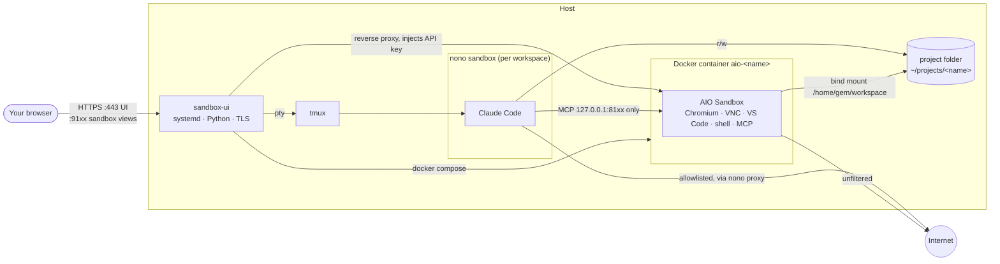

# Agent Sandboxes

Run several Claude Code projects side by side on one host. Each **workspace** is a
project folder, a Claude Code session confined by [nono](https://github.com/nolabs-ai/nono),
and its own [AIO Sandbox](https://github.com/agent-infra/sandbox) container (Chromium,
VNC, VS Code, shell, MCP) that only that session can reach. A web UI manages it all.

## Architecture



- **Claude (nono):** reads/writes its project folder; reaches only its own sandbox port
  on localhost; internet limited to nono's `claude-code` allowlist.
- **Container:** sees only its project folder; its API key is enforced, held by the
  UI and injected into Claude via a nono hook. Never in the repo.
- **UI:** token login, same-origin API, per-workspace capability URLs for sandbox views.
  Runs as your user with only `CAP_NET_BIND_SERVICE`, which it clears from the
  inheritable set once 443 is bound.

## Where things live

| Path | What |
|---|---|
| `ui/server.py`, `ui/static/` | Web UI (stdlib Python; vanilla JS; xterm.js 5.5.0 vendored, MIT) |
| `bin/sandbox-ui` | UI launcher (systemd `ExecStart`) |
| `bin/sandbox-ui-cert` | Private, name-constrained CA + server cert in `ui/tls/` |
| `bin/claude-in <name>` | Claude Code inside nono for one workspace |
| `compose.workspace.yaml` | Container template (compose project `aio-<name>`) |
| `nono/claude-browser.jsonc` → `~/.config/nono/profiles/` | nono profile |
| `nono/aio-env.sh` → `~/.config/nono/hooks/` | nono hook: gives Claude its sandbox port/key |
| `systemd/agent-sandboxes-ui.service` → `/etc/systemd/system/` | Service unit |
| `mcp.json.template` → `<project>/.mcp.json` | Claude's MCP link to its sandbox |
| `ui/tmux.conf` | tmux server for Claude sessions (`tmux -L agent-sandboxes`) |
| `workspaces/<name>.env` ✱ | Per-workspace folder, port, API key |
| `ui/token` ✱, `ui/tls/` ✱, `ui/extra-hostnames` ✱ | Login token, TLS keys, extra DNS names |

✱ created at runtime, git-ignored.

## Setup

Requires Linux with Landlock, Docker + compose, nono, tmux, python3 (3.11+), openssl and
Claude Code. Paths assume a clone at `~/agent-sandboxes` and the unit's user `metahertz`
(uid 1000); edit the unit and `nono/claude-browser.jsonc` hook path otherwise.

```bash
git clone <repo> ~/agent-sandboxes && cd ~/agent-sandboxes

nono pull nolabs-ai/claude
mkdir -p ~/.config/nono/{profiles,hooks}
cp nono/claude-browser.jsonc ~/.config/nono/profiles/
install -m 700 nono/aio-env.sh ~/.config/nono/hooks/
docker pull ghcr.io/agent-infra/sandbox:1.11.0

cp ui/extra-hostnames.example ui/extra-hostnames   # optional: add the host's DNS name

sudo install -m 644 systemd/agent-sandboxes-ui.service /etc/systemd/system/
sudo systemctl daemon-reload && sudo systemctl enable --now agent-sandboxes-ui
sudo ufw allow from <your-subnet> to any port 443,9101:9199 proto tcp
```

Then, on the machine you browse from, import `ui/tls/ca.crt` as a trusted CA (it's also
at `https://<host>/ca.crt`; check the fingerprint in `journalctl -u agent-sandboxes-ui`)
and open `https://<host>/login?token=$(cat ~/agent-sandboxes/ui/token)`.

## Usage

- **New workspace** in the sidebar: name + optional folder (default `~/projects/<name>`).
  Creates the folder, `.mcp.json`, key and port, and starts the container.
- **Tabs:** *Claude* (sandboxed session, survives closing the tab) · *Browser* (live VNC,
  shared with Claude) · *VS Code* and *Terminal* (inside the container) · *Files*
  (browse/download from the container) · *Logs*.
- **Shell access:** `bin/claude-in <name>` runs a workspace's Claude directly;
  `tmux -L agent-sandboxes attach -t cl-<name>` attaches to a UI-started session.
- **Service:** `sudo systemctl restart agent-sandboxes-ui` after editing `ui/server.py`;
  static files reload on browser refresh.

**Known gaps:** every workspace's Claude shares `~/.claude` (settings, credentials,
transcripts) and `/tmp/claude-$UID`; container egress is unfiltered.
