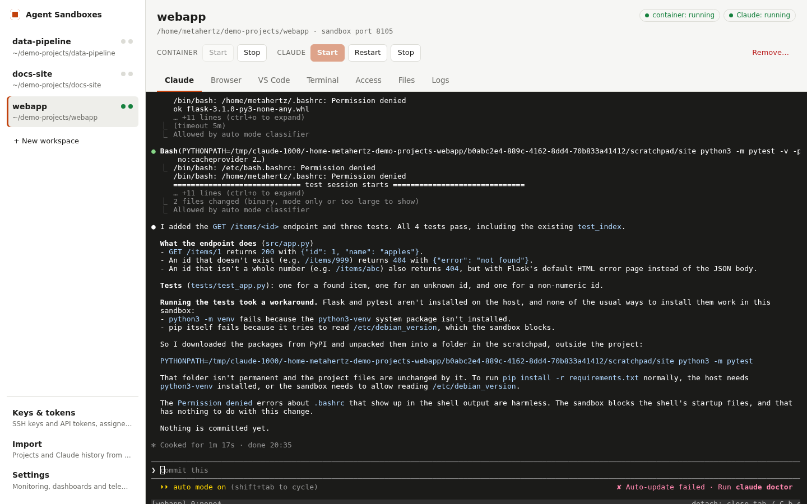
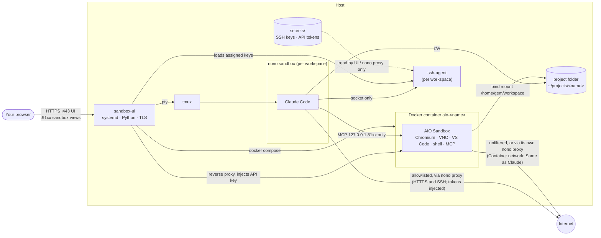
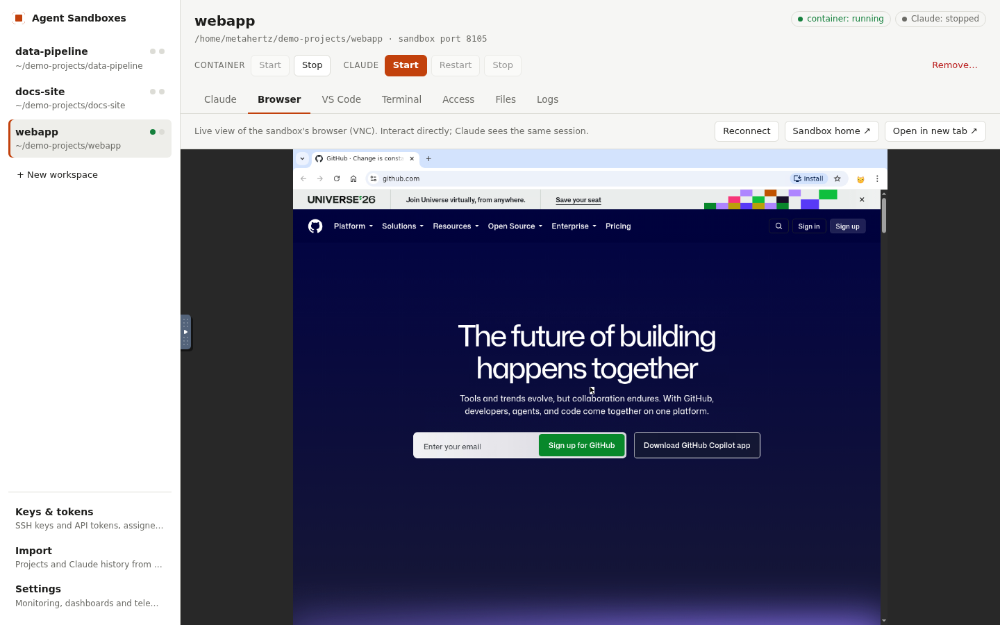
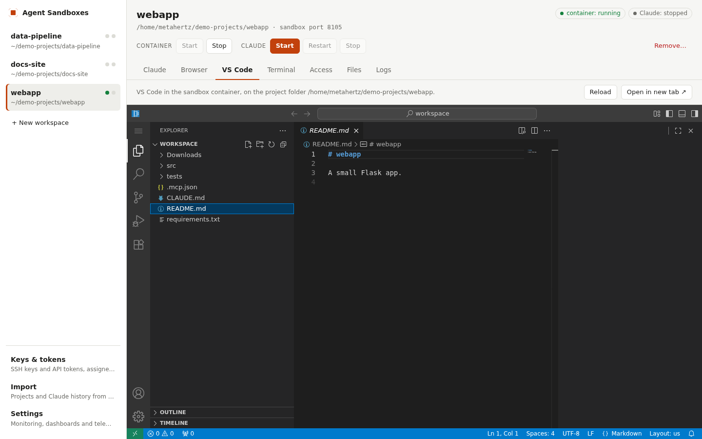
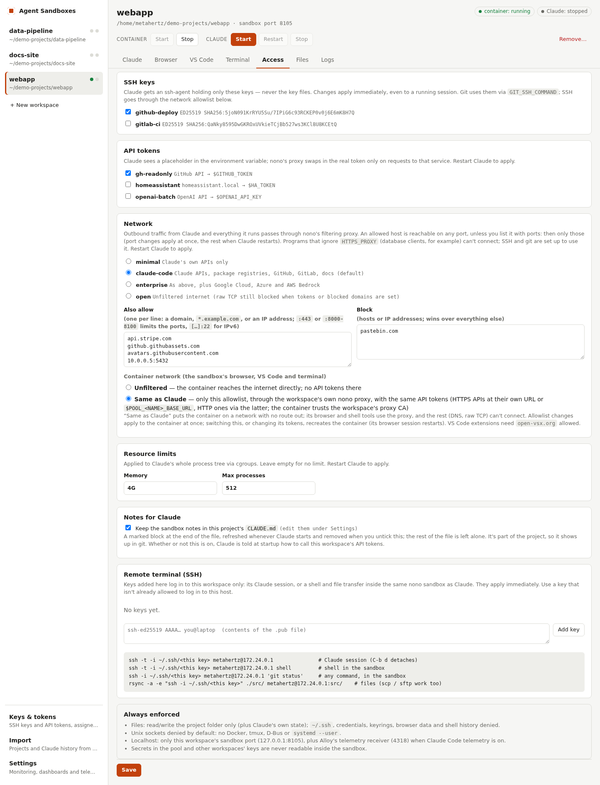
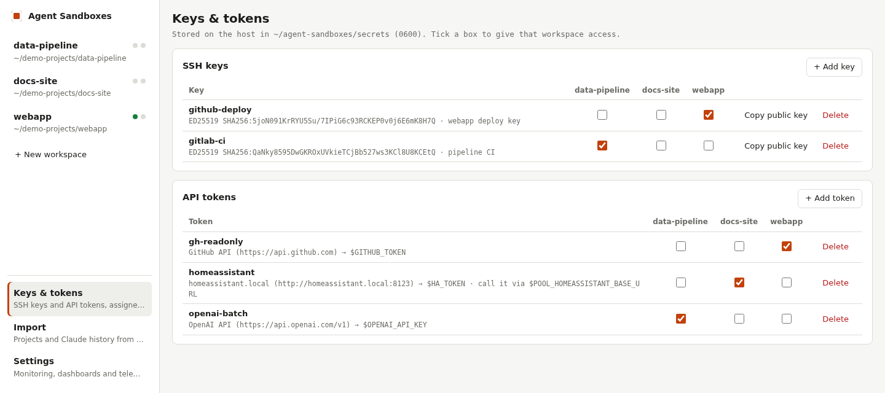
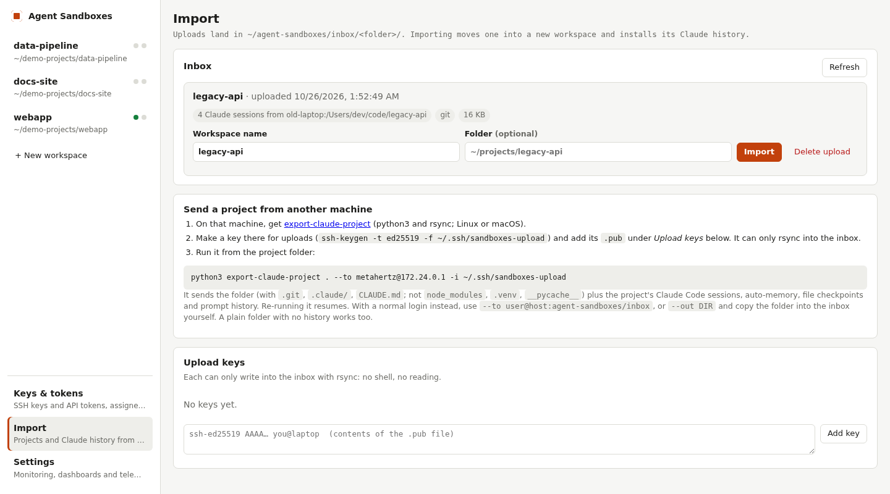
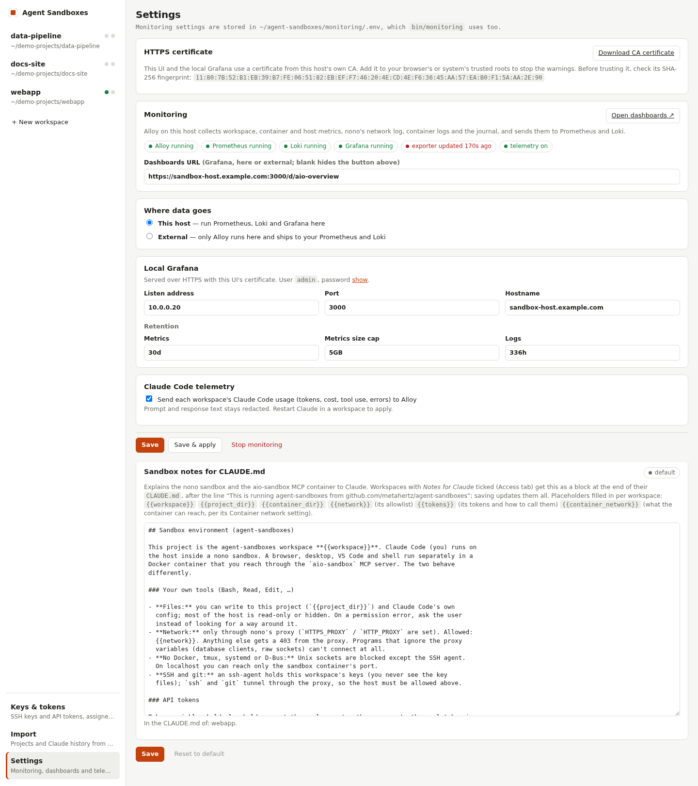

# Agent Sandboxes

Run several Claude Code projects side by side on one host. Each **workspace** is a
project folder, a Claude Code session confined by [nono](https://github.com/nolabs-ai/nono),
and its own [AIO Sandbox](https://github.com/agent-infra/sandbox) container (Chromium,
VNC, VS Code, shell, MCP) that only that session can reach. A web UI manages it all.



## Architecture



- **Claude (nono):** reads/writes its project folder; reaches only its own sandbox port
  on localhost; internet limited to the workspace's allowlist; no Unix sockets except its
  own ssh-agent (so no Docker, tmux, D-Bus). Per-workspace settings (the **Access** tab)
  are rendered to `workspaces/<name>.profile.json`, which extends `claude-browser`.
- **Keys & tokens:** a pool in `secrets/`, assigned per workspace. SSH keys are loaded
  into that workspace's ssh-agent (live — unticking a key revokes it from a running
  session); Claude gets the socket, never the file. API tokens use nono's phantom-token
  proxy: Claude sees a placeholder, the proxy injects the real token only towards that
  service.
- **Container:** sees only its project folder; its API key is enforced, held by the
  UI and injected into Claude via a nono hook. Never in the repo. Its network is
  unfiltered unless *Container network* is *Same as Claude* (see Usage).
- **Monitoring (optional):** Alloy → Prometheus + Loki → Grafana, see below.
- **UI:** token login, same-origin API, per-workspace capability URLs for sandbox views.
  Runs as your user with only `CAP_NET_BIND_SERVICE`, which it clears from the
  inheritable set once 443 is bound.

## Where things live

| Path | What |
|---|---|
| `ui/server.py`, `ui/static/` | Web UI (stdlib Python; vanilla JS; xterm.js 5.5.0 vendored, MIT) |
| `bin/sandbox-ui` | UI launcher (systemd `ExecStart`) |
| `bin/sandbox-ui-cert` | Private, name-constrained CA + server cert in `ui/tls/` |
| `bin/claude-in <name>` | Claude Code inside nono for one workspace (prepares agent + profile) |
| `libexec/ssh-proxy-connect` | SSH `ProxyCommand` through nono's proxy (readable in the sandbox) |
| `compose.workspace.yaml` | Container template (compose project `aio-<name>`) |
| `nono/claude-browser.jsonc` → `~/.config/nono/profiles/` | nono profile |
| `nono/aio-env.sh` → `~/.config/nono/hooks/` | nono hook: gives Claude its sandbox port/key |
| `systemd/agent-sandboxes-ui.service` → `/etc/systemd/system/` | Service unit |
| `mcp.json.template` → `<project>/.mcp.json` | Claude's MCP link to its sandbox |
| `ui/tmux.conf` | tmux server for Claude sessions (`tmux -L agent-sandboxes`) |
| `workspaces/<name>.env` ✱ | Per-workspace folder, port, API key |
| `workspaces/<name>.policy.json` ✱, `.profile.json` ✱ | Access settings; nono profile last used to start Claude |
| `secrets/ssh/`, `secrets/tokens/` ✱ | Key / token pool (0600; never readable inside nono) |
| `state/<name>/` ✱ | Workspace `ssh_config` and `known_hosts` (Claude-writable) |
| `$XDG_RUNTIME_DIR/agent-sandboxes/<name>/agent.sock` ✱ | Workspace ssh-agent |
| `ui/token` ✱, `ui/tls/` ✱, `ui/extra-hostnames` ✱ | Login token, TLS keys, extra DNS names |
| `bin/export-claude-project` | Run on another machine: sends a project + its Claude history to the inbox |
| `bin/ws-ssh` | SSH forced command for upload and per-workspace keys |
| `inbox/<folder>/` ✱ | Uploaded projects waiting for *Import* |
| `secrets/ssh-access.json` ✱ → `~/.ssh/authorized_keys` | Upload / workspace SSH keys (a marked block in that file) |
| `bin/monitoring`, `monitoring/compose.yaml` | Monitoring stack (compose project `agent-sandboxes-mon`) |
| `ui/exporter.py`, `systemd/agent-sandboxes-exporter.service` | Workspace metrics + nono audit events (user unit) |
| `monitoring/alloy/`, `prometheus/`, `loki/` | Collector and storage config |
| `monitoring/grafana/build-dashboards.py` → `dashboards/*.json` | Provisioned dashboards (edit the script, re-run) |
| `monitoring/.env` ✱, `monitoring/data/` ✱, `secrets/grafana-admin-password` ✱ | Monitoring settings, exporter output, Grafana data |
| `secrets/backup.json` ✱, `secrets/backup-status.json` ✱ | Backup settings (NAS password included) and recent runs |

✱ created at runtime, git-ignored.

## Setup

Requires Linux with Landlock, Docker + compose, nono, tmux, python3 (3.11+), openssl and
Claude Code; `smbclient` and `zstd` for backups. Paths assume a clone at `~/agent-sandboxes` and the unit's user `metahertz`
(uid 1000); edit the unit and `nono/claude-browser.jsonc` hook path otherwise.

```bash
git clone https://github.com/metahertz/agent-sandboxes.git ~/agent-sandboxes && cd ~/agent-sandboxes

nono pull nolabs-ai/claude
mkdir -p ~/.config/nono/{profiles,hooks}
cp nono/claude-browser.jsonc ~/.config/nono/profiles/
install -m 700 nono/aio-env.sh ~/.config/nono/hooks/
docker pull ghcr.io/agent-infra/sandbox:1.11.0

cp ui/extra-hostnames.example ui/extra-hostnames   # optional: add the host's DNS name

sudo install -m 644 systemd/agent-sandboxes-ui.service /etc/systemd/system/
sudo systemctl daemon-reload && sudo systemctl enable --now agent-sandboxes-ui
sudo ufw allow from <your-subnet> to any port 443,9101:9199 proto tcp
```

Then, on the machine you browse from, import `ui/tls/ca.crt` as a trusted CA (it's also
at `https://<host>/ca.crt`; check the fingerprint in `journalctl -u agent-sandboxes-ui`)
and open `https://<host>/login?token=$(cat ~/agent-sandboxes/ui/token)`.

## Usage

Screenshots are from a demo setup (made-up workspaces, keys and tokens).

### Workspaces

- **New workspace** in the sidebar: name + optional folder (default `~/projects/<name>`).
  Creates the folder, `.mcp.json`, key and port, and starts the container.
- **Tabs:** *Claude* (sandboxed session, survives closing the tab) · *Browser* (live VNC,
  shared with Claude) · *VS Code* and *Terminal* (inside the container) · *Access* (SSH
  keys, API tokens, network allowlist, memory/process limits) · *Files* (browse/download
  from the container) · *Logs*.





### Access tab

Per workspace: which pool keys and tokens it gets, its network allowlist and the
container's network, resource limits, the CLAUDE.md notes, and workspace-only SSH keys.



- **Network allowlist** (*Access* tab): domains, `*.domain` wildcards and IP addresses
  (IPv4, or IPv6 in canonical form; no CIDR ranges: nono's proxy matches hosts only).
  An allowed host is reachable on every port. `host:port` or `host:lo-hi` (`[v6]:port`)
  limits it to those ports: nono can't filter ports, so a workspace with such entries
  gets the UI server's port filter (`127.0.0.1:<sandbox port − 1000>`) as nono's
  `upstream_proxy`. nono checks the host first and the filter then checks the port, and
  port changes apply without a restart. While the UI server is down, such workspaces
  have no outbound network. Loopback, `0.0.0.0` and link-local addresses are refused,
  including names that resolve to them. Only programs that use `HTTPS_PROXY` (or, for
  SSH, `ssh-proxy-connect`) get out; raw TCP clients such as `psql` stay blocked.
- **Container network** (*Access* tab): *Same as Claude* gives the AIO container the
  workspace's allowlist and API tokens. `compose()` adds a generated override
  (`workspaces/<name>.compose-filtered.yaml`): an internal Docker network
  `10.231.<port−8100>.0/24` (no route out, no DNS, no published port; `AIO_CONTAINER_NET`
  changes the prefix), the container at `.2`, and an env file pointing AIO's GOST relay
  (so Chromium), `HTTP(S)_PROXY`, and each token variable / `$POOL_<NAME>_BASE_URL` at a
  `nono proxy` the UI server runs on the gateway `.1:3128` with the workspace's profile
  and its own password (`secrets/container-proxy/<name>`, also the token placeholder
  there). The UI server forwards `127.0.0.1:<sandbox port>` to `.2:8080`, so MCP, the UI
  and VNC work as before. Allowlist changes restart only that proxy; switching, or
  changing tokens, recreates the container. While the UI server is down such containers
  are offline.
  Token hosts also work at their real HTTPS URL: nono intercepts TLS for them (only
  them) with a persistent per-workspace CA (`secrets/container-proxy/<name>.ca.{crt,key}`;
  the key never enters the container). The container mounts the certificate into
  `/usr/local/share/ca-certificates/`, and AIO's `RUN_HOOK_INIT` runs
  `update-ca-certificates` at every start; Chromium, which ignores the system store,
  gets a managed `CACertificates` policy; `NODE_EXTRA_CA_CERTS`, `REQUESTS_CA_BUNDLE`
  and `PIP_CERT` cover Node and Python, and `NODE_USE_ENV_PROXY=1` makes Node's `fetch`
  use the proxy. Tested with curl, Python requests, Node fetch and Chromium.
- **Notes for Claude:** Claude is started with `--append-system-prompt` naming each of the
  workspace's API tokens and how to call it (for `http://` APIs: `$POOL_<NAME>_BASE_URL`
  only). Ticking *Notes for Claude* (*Access* tab) also keeps a marked block at the end of
  the project's `CLAUDE.md`, rendered from `ui/claude-md-additions.md` (edited copy under
  *Settings*, saved to `state/claude-md-additions.md`): what nono allows, how the
  aio-sandbox MCP container differs (other paths, its network, no SSH keys), with
  the workspace's allowlist and tokens filled in. Refreshed at every Claude start.
- **Remote terminal** (*Access* tab): SSH keys that reach one workspace only. See
  [SSH into a workspace](#ssh-into-a-workspace).

### Keys & tokens



- **Keys & tokens** (sidebar): generate or import SSH keys (copy the public key into
  GitHub etc.), add API tokens (GitHub, GitLab, OpenAI, Gemini, or any HTTP(S) API), and tick
  which workspaces get each. nono only injects tokens into plain HTTP on loopback, so an
  `http://` API's route goes to the UI server's bridge on `127.0.0.2:7100`, which relays to
  the real host (one request per connection, so nono's keep-alive can't mix tokens). Claude
  calls it via `$POOL_<NAME>_BASE_URL`; the token crosses the network unencrypted.
  Inside the sandbox, `git` uses the keys via `GIT_SSH_COMMAND`;
  SSH hosts must be on the allowlist (add e.g. `git.example.com` under *Also allow*).
  Network, token and limit changes need a Claude restart; the header says when.

### Import



- **Import** (sidebar): projects from other machines, with their Claude Code history.
  See [Importing projects](#importing-projects).

### Settings



- **Settings** (sidebar): monitoring — dashboards link, local or external Prometheus /
  Loki, local Grafana address and retention, Claude Code telemetry — with *Save & apply*
  and *Stop monitoring*. See [Monitoring](#monitoring).
- **HTTPS certificate** (*Settings*): download the UI's CA (`/ca.crt`) with its SHA-256
  fingerprint, to trust it in your browser or system.
- **Sandbox notes** (*Settings*): edit the CLAUDE.md block described above; *Reset to
  default* goes back to `ui/claude-md-additions.md`.
- **Backup** (*Settings*): tarballs of the workspace folders, this app's settings and
  secrets, and Claude Code's config, copied to an SMB share on a schedule, with old ones
  pruned. See [Backup](#backup).

### From the shell

- **Shell access:** `bin/claude-in <name>` runs a workspace's Claude directly;
  `tmux -L agent-sandboxes attach -t cl-<name>` attaches to a UI-started session.
- **Service:** `sudo systemctl restart agent-sandboxes-ui` after editing `ui/server.py`;
  static files reload on browser refresh.

## Importing projects

On the machine the project is on now (Linux or macOS, python3 + rsync), get
`export-claude-project` (link on the *Import* page, or `bin/` here) and run:

```bash
ssh-keygen -t ed25519 -f ~/.ssh/sandboxes-upload     # add the .pub under Import → Upload keys
python3 export-claude-project ~/code/my-app --to metahertz@<host> -i ~/.ssh/sandboxes-upload
```

It uploads to `inbox/my-app/`: the folder (with `.git`, `.claude/`, `CLAUDE.md`; without
`node_modules`, `.venv`, `__pycache__` unless `--include-all`), plus `.claude-import/` with
the project's Claude Code sessions and auto-memory (`~/.claude/projects/<project>/`), their
file checkpoints and todos, its prompt history, and a manifest (sent last, so a half-done
upload isn't importable). Upload keys can only rsync into the inbox (`rrsync -wo -munge`:
no shell, no reading; symlinks are stored defused and restored on import). With a normal
login use `--to user@host:agent-sandboxes/inbox`; or `--out DIR` and copy the folder in
any way. A plain folder with no `.claude-import/` imports too, without history.

*Import* moves the folder to `~/projects/<name>` (or the folder you give; never merging
into an existing one), creates the workspace, and installs the history under the new path
(`cwd` in transcripts rewritten), so `/resume` and `claude -c` pick conversations up.

## SSH into a workspace

Keys added in a workspace's *Access → Remote terminal* get a forced command
(`bin/ws-ssh <name>`, `restrict`) in `~/.ssh/authorized_keys`:

```bash
ssh -t -i ~/.ssh/key me@host            # attach to its Claude session (started if needed)
ssh -t -i ~/.ssh/key me@host shell      # bash inside the workspace's nono sandbox
ssh -i ~/.ssh/key me@host 'git status'  # any command, in the sandbox; rsync / scp / sftp too
```

Everything except the Claude session runs through `claude-in --shell / --exec`, i.e. under
that workspace's own nono profile: the key reaches exactly what Claude there can. No port
forwarding. tmux is configured so attached clients (SSH or the web terminal) can only
detach (`C-b d`) and scroll (`C-b [`), not open windows or switch sessions. Use a key per
workspace, and not one that already logs in to the account unrestricted (sshd would use
that line first; the UI refuses such keys).

## Backup

**Settings → Backup to a NAS** packs a tarball and copies it to an SMB (CIFS) share. It
uses `smbclient` (`sudo apt install smbclient`), so nothing is mounted and the service
needs no root.

- **NAS:** server (optionally `:port`), share, folder on the share (created if missing),
  username, password and optional domain. They're saved in `secrets/backup.json` (0600,
  never readable inside nono), and the password is never sent back to the browser.
  *Save & test connection* checks the login and folder and shows the free space.
- **What goes in:** any of the workspace folders; this app's settings and secrets
  (`workspaces/`, `state/`, `secrets/`, `ui/token`, `ui/tls/`, `ui/extra-hostnames`,
  `monitoring/.env`); and Claude Code's config (`~/.claude`, `~/.claude.json`: sessions,
  memory, settings, login). `node_modules`, `.venv` and `__pycache__` are left out
  unless you untick that. The NAS password itself isn't included.
- **Schedule:** off, daily or weekly at a time in the host's local time. A run missed
  while the host was down starts once the UI is back. *Back up now* runs one at any time.
- **Retention:** after each backup, this host's backups older than *Keep backups for*
  days are deleted, but never the newest one. Uploads that didn't finish are deleted
  after a day. *Backups on the NAS* lists the folder, with *Delete* per file and
  *Prune now*. Files are named `agent-sandboxes-<host>-<UTC time>.tar.zst`, so several
  hosts can share a folder; each prunes only its own.

The tarball is built under `secrets/backup-staging/`, so the disk needs room for one
compressed copy. It's uploaded as `<name>.part` and renamed once complete. Files that
can't be read, or that change while being read, are reported as warnings on that run;
they don't fail it. The tarball is **not encrypted**: with the second and third options
ticked it holds private SSH keys, API tokens and Claude's login, so keep the share
private to you.

To restore, copy a tarball back, then:

```bash
tar -tf agent-sandboxes-<host>-<time>.tar.zst                    # look first
tar -xOf agent-sandboxes-<host>-<time>.tar.zst BACKUP-MANIFEST.json   # what's inside
tar -xf agent-sandboxes-<host>-<time>.tar.zst -C ~/restore       # into a scratch folder, or
sudo systemctl stop agent-sandboxes-ui; tar -xf agent-sandboxes-<host>-<time>.tar.zst -C /   # in place
```

Paths are stored relative to `/`. Stop Claude in the workspaces before restoring in place.

## Monitoring

Start it from **Settings → Save & apply** in the UI, or from a shell:

```bash
bin/monitoring up          # first run writes monitoring/.env; also starts the exporter
bin/monitoring password    # Grafana admin password (also on the Settings page)
sudo ufw allow from <your-subnet> to any port 3000 proto tcp
```

Grafana is at `https://<host>:3000/` (same certificate as the UI), with two dashboards
in *Agent Sandboxes*: **overview** (every workspace's sandbox / Claude / policy state,
CPU and memory, tokens and cost, network denials, host) and **workspace** (one
workspace in detail, with its logs). What's collected:

| Source | Into | What |
|---|---|---|
| `ui/exporter.py` (every 15 s) | Prometheus `aio_*` | Container up/healthy, Claude running, policy pending, keys/tokens, limits, project size; Claude scope CPU / memory / processes / OOM kills |
| nono audit trail (via the exporter) | Loki `{source="nono"}`, `aio_nono_*` | Session start/end, every connection allowed or denied, with workspace |
| Claude Code OpenTelemetry | Loki `{service_name="claude-code"}`, Prometheus `claude_code_*` | API requests (tokens, cost, model), tool use and decisions, errors; prompt and response text stays redacted |
| cAdvisor (in Alloy) | Prometheus `container_*{workspace=…}` | Sandbox container CPU, memory, network |
| node exporter (in Alloy) | Prometheus `node_*` | Host CPU, memory, disk, load |
| Docker, journald | Loki `{source="docker"}`, `{source="journal"}` | `aio-*` / `mon-*` container logs; system journal |

Once `monitoring/.env` exists (and unless telemetry is switched off in Settings,
`CLAUDE_TELEMETRY=0`), workspace profiles add Claude Code's telemetry settings and open
localhost:4318 (Alloy's OTLP receiver) to the sandbox, so sessions started from then on
report. Prometheus and Loki aren't published outside the compose network.

To use an external Prometheus and Grafana, choose **External** under *Where data goes*
(`MON_STACK=0`) with its remote-write and Loki URLs, set the **Dashboards URL**
(`MONITORING_URL`) to your Grafana, import `monitoring/grafana/dashboards/*.json` there
(datasource UIDs `prometheus` and `loki`), then *Save & apply*: only Alloy and the
exporter keep running here; the local containers are removed, their volumes kept.
Remote-write / Loki authentication isn't wired up yet. Default retention: 30 days / 5 GB of metrics, 14 days of logs.

After updating, a tmux server that was already running keeps its old key bindings:
`tmux -L agent-sandboxes source-file ui/tmux.conf` applies the locked-down ones.

Claude always runs in a `systemd --user` scope (`claude-<name>-<pid>`, for resource
limits and its metrics), which needs lingering (`sudo loginctl enable-linger <user>`).

**Known gaps:** every workspace's Claude shares `~/.claude` (settings, credentials,
transcripts) and `/tmp/claude-$UID`; container egress is unfiltered unless *Container
network* is *Same as Claude*; SSH host keys are
trust-on-first-use per workspace; pool secrets are unencrypted at rest (like `~/.ssh`);
telemetry's `workspace` label is set by the sandbox, so a workspace could mislabel its
own Claude metrics (nono and container data are labelled outside it); Alloy has the
Docker socket (root-equivalent, as any container monitor does); imported history lands in
that shared `~/.claude` too; upload and workspace SSH keys log in as this account (their
forced command is the boundary), and an upload key can fill the disk.
