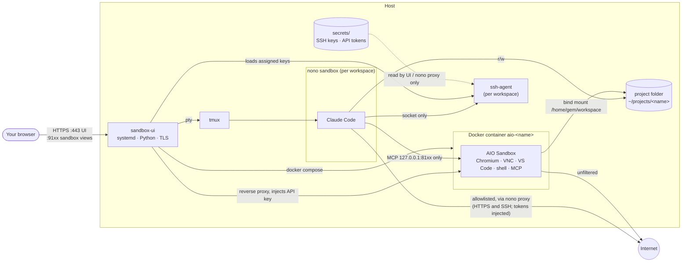

# Agent Sandboxes

Run several Claude Code projects side by side on one host. Each **workspace** is a
project folder, a Claude Code session confined by [nono](https://github.com/nolabs-ai/nono),
and its own [AIO Sandbox](https://github.com/agent-infra/sandbox) container (Chromium,
VNC, VS Code, shell, MCP) that only that session can reach. A web UI manages it all.

## Architecture



- **Claude (nono):** reads/writes its project folder; reaches only its own sandbox port
  on localhost; internet limited to the workspace's allowlist; no Unix sockets except its
  own ssh-agent (so no Docker, tmux, D-Bus). Per-workspace settings (the **Access** tab)
  are rendered to `workspaces/<name>.profile.json`, which extends `claude-browser`.
- **Keys & tokens:** a pool in `secrets/`, assigned per workspace. SSH keys are loaded
  into that workspace's ssh-agent (live — unticking a key revokes it from a running
  session); Claude gets the socket, never the file. API tokens use nono's phantom-token
  proxy: Claude sees a placeholder, the proxy injects the real token only towards that
  service.
- **Container:** sees only its project folder; its API key is enforced, held by the
  UI and injected into Claude via a nono hook. Never in the repo.
- **Monitoring (optional):** Alloy → Prometheus + Loki → Grafana, see below.
- **UI:** token login, same-origin API, per-workspace capability URLs for sandbox views.
  Runs as your user with only `CAP_NET_BIND_SERVICE`, which it clears from the
  inheritable set once 443 is bound.

## Where things live

| Path | What |
|---|---|
| `ui/server.py`, `ui/static/` | Web UI (stdlib Python; vanilla JS; xterm.js 5.5.0 vendored, MIT) |
| `bin/sandbox-ui` | UI launcher (systemd `ExecStart`) |
| `bin/sandbox-ui-cert` | Private, name-constrained CA + server cert in `ui/tls/` |
| `bin/claude-in <name>` | Claude Code inside nono for one workspace (prepares agent + profile) |
| `libexec/ssh-proxy-connect` | SSH `ProxyCommand` through nono's proxy (readable in the sandbox) |
| `compose.workspace.yaml` | Container template (compose project `aio-<name>`) |
| `nono/claude-browser.jsonc` → `~/.config/nono/profiles/` | nono profile |
| `nono/aio-env.sh` → `~/.config/nono/hooks/` | nono hook: gives Claude its sandbox port/key |
| `systemd/agent-sandboxes-ui.service` → `/etc/systemd/system/` | Service unit |
| `mcp.json.template` → `<project>/.mcp.json` | Claude's MCP link to its sandbox |
| `ui/tmux.conf` | tmux server for Claude sessions (`tmux -L agent-sandboxes`) |
| `workspaces/<name>.env` ✱ | Per-workspace folder, port, API key |
| `workspaces/<name>.policy.json` ✱, `.profile.json` ✱ | Access settings; nono profile last used to start Claude |
| `secrets/ssh/`, `secrets/tokens/` ✱ | Key / token pool (0600; never readable inside nono) |
| `state/<name>/` ✱ | Workspace `ssh_config` and `known_hosts` (Claude-writable) |
| `$XDG_RUNTIME_DIR/agent-sandboxes/<name>/agent.sock` ✱ | Workspace ssh-agent |
| `ui/token` ✱, `ui/tls/` ✱, `ui/extra-hostnames` ✱ | Login token, TLS keys, extra DNS names |
| `bin/monitoring`, `monitoring/compose.yaml` | Monitoring stack (compose project `agent-sandboxes-mon`) |
| `ui/exporter.py`, `systemd/agent-sandboxes-exporter.service` | Workspace metrics + nono audit events (user unit) |
| `monitoring/alloy/`, `prometheus/`, `loki/` | Collector and storage config |
| `monitoring/grafana/build-dashboards.py` → `dashboards/*.json` | Provisioned dashboards (edit the script, re-run) |
| `monitoring/.env` ✱, `monitoring/data/` ✱, `secrets/grafana-admin-password` ✱ | Monitoring settings, exporter output, Grafana data |

✱ created at runtime, git-ignored.

## Setup

Requires Linux with Landlock, Docker + compose, nono, tmux, python3 (3.11+), openssl and
Claude Code. Paths assume a clone at `~/agent-sandboxes` and the unit's user `metahertz`
(uid 1000); edit the unit and `nono/claude-browser.jsonc` hook path otherwise.

```bash
git clone <repo> ~/agent-sandboxes && cd ~/agent-sandboxes

nono pull nolabs-ai/claude
mkdir -p ~/.config/nono/{profiles,hooks}
cp nono/claude-browser.jsonc ~/.config/nono/profiles/
install -m 700 nono/aio-env.sh ~/.config/nono/hooks/
docker pull ghcr.io/agent-infra/sandbox:1.11.0

cp ui/extra-hostnames.example ui/extra-hostnames   # optional: add the host's DNS name

sudo install -m 644 systemd/agent-sandboxes-ui.service /etc/systemd/system/
sudo systemctl daemon-reload && sudo systemctl enable --now agent-sandboxes-ui
sudo ufw allow from <your-subnet> to any port 443,9101:9199 proto tcp
```

Then, on the machine you browse from, import `ui/tls/ca.crt` as a trusted CA (it's also
at `https://<host>/ca.crt`; check the fingerprint in `journalctl -u agent-sandboxes-ui`)
and open `https://<host>/login?token=$(cat ~/agent-sandboxes/ui/token)`.

## Usage

- **New workspace** in the sidebar: name + optional folder (default `~/projects/<name>`).
  Creates the folder, `.mcp.json`, key and port, and starts the container.
- **Tabs:** *Claude* (sandboxed session, survives closing the tab) · *Browser* (live VNC,
  shared with Claude) · *VS Code* and *Terminal* (inside the container) · *Access* (SSH
  keys, API tokens, network allowlist, memory/process limits) · *Files* (browse/download
  from the container) · *Logs*.
- **Keys & tokens** (sidebar): generate or import SSH keys (copy the public key into
  GitHub etc.), add API tokens (GitHub, GitLab, OpenAI, Gemini, or any HTTPS API), and tick
  which workspaces get each. Inside the sandbox, `git` uses the keys via `GIT_SSH_COMMAND`;
  SSH hosts must be on the allowlist (add e.g. `git.example.com` under *Also allow*).
  Network, token and limit changes need a Claude restart; the header says when.
- **Shell access:** `bin/claude-in <name>` runs a workspace's Claude directly;
  `tmux -L agent-sandboxes attach -t cl-<name>` attaches to a UI-started session.
- **Service:** `sudo systemctl restart agent-sandboxes-ui` after editing `ui/server.py`;
  static files reload on browser refresh.

## Monitoring

```bash
bin/monitoring up          # first run writes monitoring/.env; also starts the exporter
bin/monitoring password    # Grafana admin password
sudo ufw allow from <your-subnet> to any port 3000 proto tcp
```

Grafana is at `https://<host>:3000/` (same certificate as the UI), with two dashboards
in *Agent Sandboxes*: **overview** (every workspace's sandbox / Claude / policy state,
CPU and memory, tokens and cost, network denials, host) and **workspace** (one
workspace in detail, with its logs). What's collected:

| Source | Into | What |
|---|---|---|
| `ui/exporter.py` (every 15 s) | Prometheus `aio_*` | Container up/healthy, Claude running, policy pending, keys/tokens, limits, project size; Claude scope CPU / memory / processes / OOM kills |
| nono audit trail (via the exporter) | Loki `{source="nono"}`, `aio_nono_*` | Session start/end, every connection allowed or denied, with workspace |
| Claude Code OpenTelemetry | Loki `{service_name="claude-code"}`, Prometheus `claude_code_*` | API requests (tokens, cost, model), tool use and decisions, errors; prompt and response text stays redacted |
| cAdvisor (in Alloy) | Prometheus `container_*{workspace=…}` | Sandbox container CPU, memory, network |
| node exporter (in Alloy) | Prometheus `node_*` | Host CPU, memory, disk, load |
| Docker, journald | Loki `{source="docker"}`, `{source="journal"}` | `aio-*` / `mon-*` container logs; system journal |

Once `monitoring/.env` exists, workspace profiles add Claude Code's telemetry settings
and open localhost:4318 (Alloy's OTLP receiver) to the sandbox, so sessions started from
then on report. Prometheus and Loki aren't published outside the compose network; to
ship to existing ones instead, set `MON_STACK=0` and `PROM_WRITE_URL` / `LOKI_URL` in
`monitoring/.env`. Retention: 30 days / 5 GB of metrics, 14 days of logs.

Claude always runs in a `systemd --user` scope (`claude-<name>-<pid>`, for resource
limits and its metrics), which needs lingering (`sudo loginctl enable-linger <user>`).

**Known gaps:** every workspace's Claude shares `~/.claude` (settings, credentials,
transcripts) and `/tmp/claude-$UID`; container egress is unfiltered; SSH host keys are
trust-on-first-use per workspace; pool secrets are unencrypted at rest (like `~/.ssh`);
telemetry's `workspace` label is set by the sandbox, so a workspace could mislabel its
own Claude metrics (nono and container data are labelled outside it); Alloy has the
Docker socket (root-equivalent, as any container monitor does).
